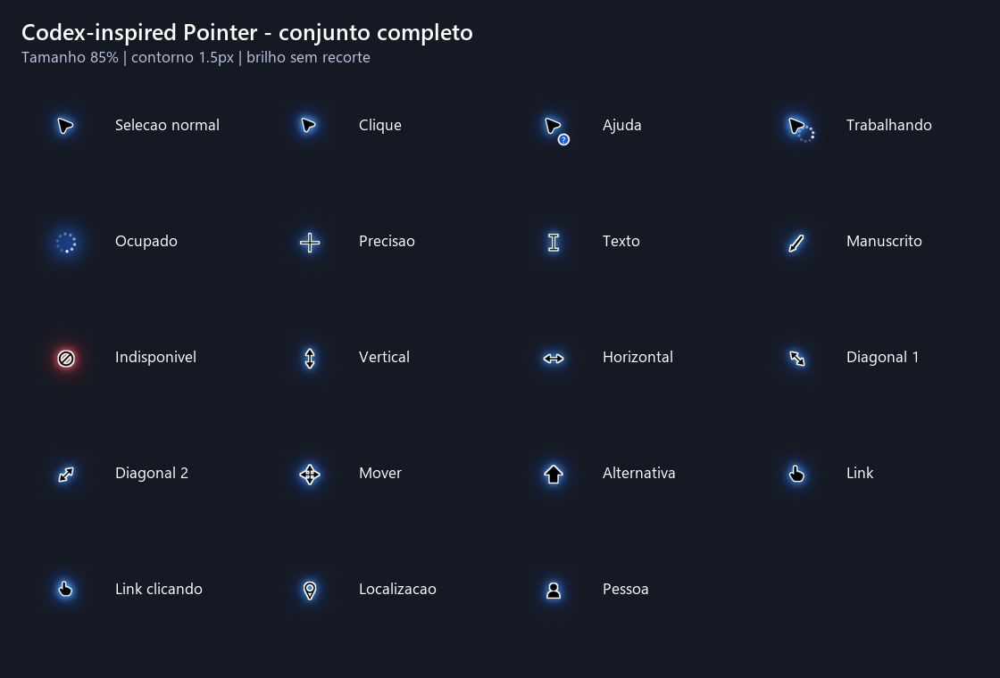

# Codex-inspired Pointer v3.2

Ponteiros para Windows 10 e 11 com contorno branco, brilho difuso, animações de espera e movimento opcional de clique e arraste. O conjunto tem 17 funções do Windows e 21 combinações prontas de tamanho e espessura da borda. Cor, raio e intensidade do brilho são configuráveis. O símbolo **Indisponível** usa brilho vermelho.

Este é um projeto independente, inspirado no visual do ponteiro do Codex. **Não é um produto oficial da OpenAI.** O download e o uso são gratuitos.



## Baixar e instalar

1. Na página da [versão v3.2.0](https://github.com/davi-ramon/Codex-Inspired-Pointer-v3/releases/tag/v3.2.0), baixe **Codex-Inspired-Pointer-Windows-v3.2.zip** em **Assets**. Use esse arquivo para instalar: o botão **Code → Download ZIP** baixa apenas o código-fonte, sem os ponteiros gerados.
2. Extraia o ZIP inteiro para uma pasta.
3. Abra **Configure.exe** com dois cliques. Escolha tamanho, borda, cor, raio e intensidade do brilho e se deseja o movimento suave; clique em **Aplicar ao Windows**. Se já usava a versão anterior, este passo também atualiza o auxiliar. Para instalar diretamente o ajuste padrão, abra **Install.cmd**.
4. Para trocar o esquema nas configurações do Windows, abra **Propriedades do Mouse → Ponteiros** e escolha **Codex-inspired Blue Glow 2**. Se essa janela já estava aberta, feche e abra novamente.

O ajuste padrão é **85%** de tamanho, **1,5 px** de borda, brilho azul com raio de 120% e intensidade de 130%. Há tamanhos de 70%, 75%, 85%, 95%, 110%, 125% e 150%, com bordas de 1,3, 1,5 ou 1,7 px. A instalação vale para a conta atual do Windows, não exige administrador e persiste após reiniciar. Um iniciador mantém o auxiliar ativo e uma tarefa de login com atraso de 20 segundos oferece uma segunda forma de iniciá-lo.

Abra **CursorTestPanel.exe** ou clique em **Testar ponteiros** no configurador para percorrer as 17 funções em tamanho real, incluindo texto, carregamento, redimensionamentos e mapa de arrastar.

Para voltar aos ponteiros anteriores, clique em **Restaurar anteriores** no configurador ou abra **Uninstall.cmd**. A primeira instalação guarda uma cópia das configurações de ponteiro da conta atual.

## O que vem no pacote

- Cursores para seta, ajuda, trabalho, ocupado, precisão, texto, manuscrito, indisponível, redimensionamentos, mover, seleção alternativa, link, localização e pessoa.
- Animações nativas de carregamento para trabalho e ocupado. O auxiliar aplica o movimento à função visível, até 30 vezes por segundo, para evitar piscadas entre cursores.
- Mão aberta e fechada no mapa do painel. Alguns aplicativos, especialmente mapas e páginas web, usam cursores próprios; o esquema do Windows não substitui esses desenhos do aplicativo.
- Arquivos `.cur` e `.ani` com imagens próprias de 32, 48, 64, 96, 128 e 256 pixels. O Windows escolhe uma imagem adequada ao tamanho de tela sem reduzir o desenho inteiro a poucos pixels. O brilho personalizado é gerado na cópia instalada; a prévia mostra o azul padrão.
- Instalador, configurador, desinstalador e código-fonte. O uso do ZIP pronto não requer Python, Pillow nem internet.

O instalador usa `%LOCALAPPDATA%\Codex Pointer` para os arquivos ativos. Os arquivos `motion.log` e `motion-launcher.log` nessa pasta ajudam a diagnosticar a inicialização. O executável e os scripts não têm assinatura digital; o Windows pode pedir confirmação para executá-los.

## Código-fonte

O gerador visual está em [build_package.py](build_package.py) e precisa de Python 3 com Pillow para criar os presets. [add_small_cursor_frames.py](add_small_cursor_frames.py) migra pacotes gerados anteriormente. [export_render_sources.py](export_render_sources.py) extrai as imagens usadas pelo movimento. [Configurator.cs](Configurator.cs), [CursorMotionV3.cs](CursorMotionV3.cs), [CursorTheme.cs](CursorTheme.cs) e [CursorTestPanel.cs](CursorTestPanel.cs) contêm o configurador, o auxiliar, o gerador de brilho e o painel de testes. Os scripts PowerShell cuidam da instalação e restauração. Para editar o projeto, gere novamente as 21 combinações e compile os três executáveis antes de montar um novo ZIP. Os arquivos gerados ficam na Release para manter o repositório leve.

## Integridade do download

SHA-256 de `Codex-Inspired-Pointer-Windows-v3.2.zip`:

```text
2E399C39BDB47AA0A1F03E55A32F84D3A4652BD344718654EFC08DA491C5D2AC
```

No PowerShell, confira com `Get-FileHash .\Codex-Inspired-Pointer-Windows-v3.2.zip -Algorithm SHA256`.
